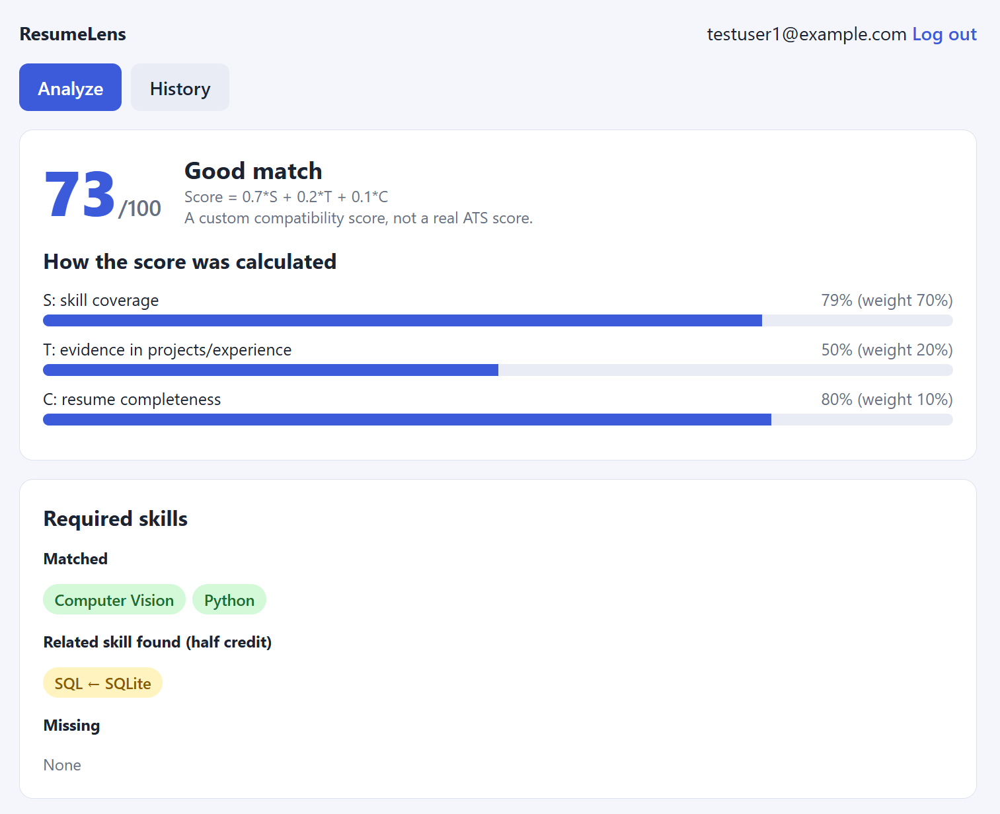
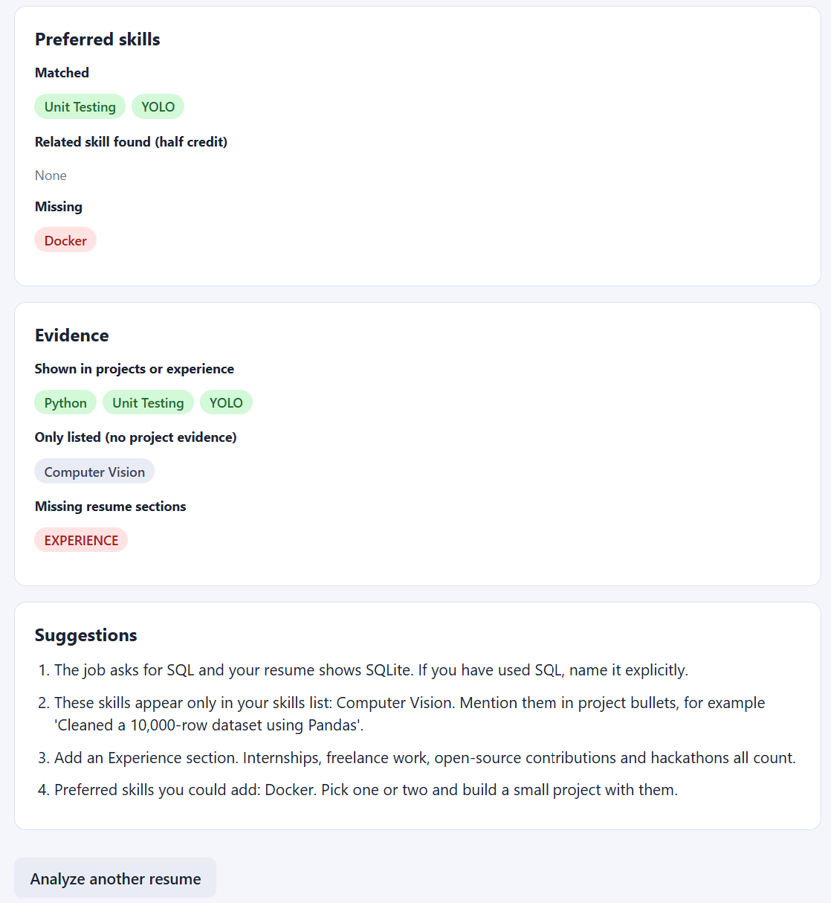
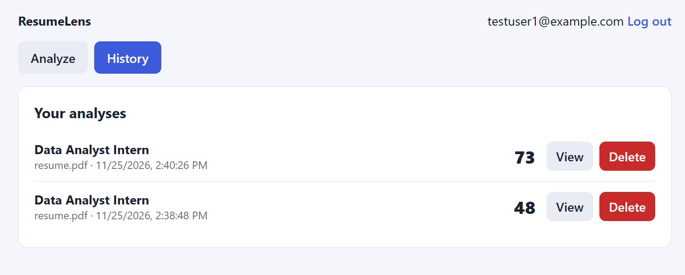
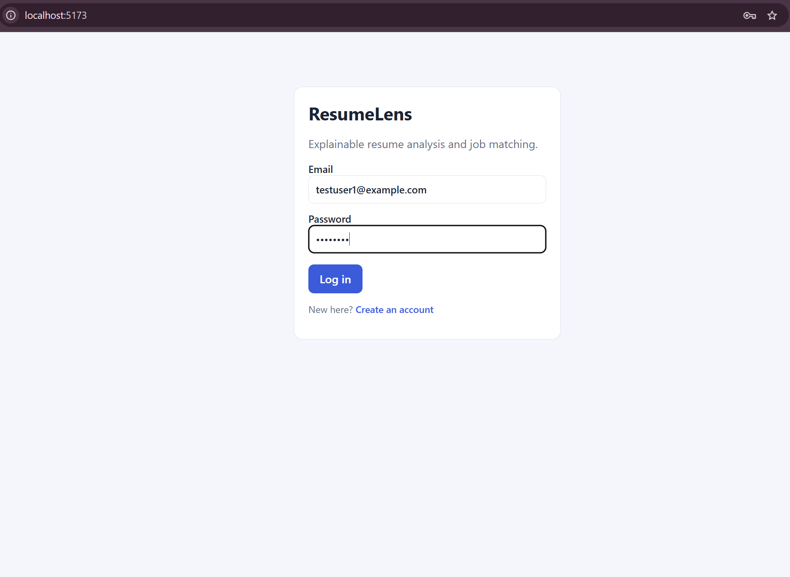

# ResumeLens

Explainable resume analysis and job matching, built with Java, Spring Boot and React.

ResumeLens reads a resume (PDF or DOCX), extracts skills, compares them with a job
description, and returns a compatibility score together with a clear explanation of how
it was calculated. The score is a custom metric, not a real ATS score.

## Screenshots

**Results: score breakdown and required skills**



**Results: evidence and suggestions**



**History**



**Login**


## How the score works

`Score = 0.7·S + 0.2·T + 0.1·C`

| Term | Meaning | Calculation |
|------|---------|-------------|
| S | Skill coverage | Required skills (75%) and preferred skills (25%). Exact match = 1.0, related skill = 0.5 |
| T | Evidence | Share of the job's skills that appear in Projects or Experience, not only in the skills list |
| C | Completeness | Checklist: email, Education, Skills, Projects, Experience |

Every number in the result can be traced back to specific skills and rules, and the
results page shows the three terms as separate bars.

## Features

- PDF and DOCX text extraction (Apache PDFBox, Apache POI)
- Skill dictionary with synonym normalization (ML = Machine Learning, ReactJS = React)
- Whole-term matching, so "Java" never matches inside "JavaScript"
- Partial credit for related skills (for example SQLite for SQL)
- Resume section detection (Education, Skills, Projects, Experience)
- Rule-based improvement suggestions, ordered by priority
- User accounts with JWT authentication; each user sees only their own history
- Saved analysis history (create, view, delete)
- React frontend: login, upload form, results dashboard, history

## Tech stack

| Layer | Technology |
|---|---|
| Backend | Java 21, Spring Boot 3, Spring Security, Spring Data JPA |
| Database | H2 (file mode, for development) |
| Auth | JWT (jjwt), BCrypt password hashing |
| File parsing | Apache PDFBox, Apache POI |
| Frontend | React, Vite |
| Testing | JUnit 5, Spring MockMvc |

## Architecture

```
React (Vite)  ->  Controller  ->  Service  ->  Engine (plain Java)  ->  Repository  ->  Database
```

- **Controller** handles HTTP, validation and status codes.
- **Service** coordinates file reading, analysis and saving.
- **Engine** (`engine` package) holds the analysis logic and has no Spring dependency,
  so it is tested on its own: skill extractor, matcher, section parser, score calculator
  and suggestion generator.

## Run it locally

**Requirements:** JDK 21, Node.js 20 or newer.

1. **Backend:** open the project in IntelliJ IDEA and run `ResumeLensApplication`.
   It starts on `http://localhost:8080`.
2. **Frontend:**
   ```
   cd frontend
   npm install
   npm run dev
   ```
3. Open `http://localhost:5173`, create an account, and upload a resume.

The database is created automatically in a `data/` folder (ignored by Git).

For anything beyond local use, set the `JWT_SECRET` environment variable to a long
random value. The default in `application.properties` is for development only.

## API

| Method | URL | Auth | Description |
|--------|-----|------|-------------|
| GET | `/api/health` | no | Health check |
| POST | `/api/auth/register` | no | Create an account. JSON: `email`, `password` (8 to 72 characters) |
| POST | `/api/auth/login` | no | Log in. Returns a token |
| POST | `/api/analyze` | yes | Form-data: `resume` (PDF/DOCX), `jobDescription`, `jobTitle` (optional) |
| GET | `/api/analyses` | yes | List your saved analyses |
| GET | `/api/analyses/{id}` | yes | Get one saved analysis |
| DELETE | `/api/analyses/{id}` | yes | Delete one saved analysis |

Send the token as `Authorization: Bearer <token>`. Another user's analysis returns
404, so ids cannot be guessed.

## Tests

Run all tests from IntelliJ (right-click `src/test` and choose Run Tests). They cover the
engine, the API endpoints, authentication and per-user isolation.

## Known limitations

- Scanned (image-only) PDFs are not supported, because there is no OCR
- Skill detection is keyword-based, so a skill is found only if the dictionary knows it
- Evidence (T) counts a skill only when its exact name appears in Projects or Experience
- Section detection relies on common headings such as "Education" or "Projects"
- Job descriptions need "Required" or "Preferred" markers to split skills; without them
  every skill counts as required
- H2 is used for development. Resume text is stored in the database, so do not expose
  this server publicly without reviewing privacy and security first
- No refresh tokens or login rate limiting

## Roadmap

- [x] Core engine: extraction, matching, scoring, suggestions
- [x] REST API for resume upload and analysis
- [x] Analysis history
- [x] Authentication (JWT) and per-user history
- [x] React frontend
- [ ] MySQL
- [ ] Compare one resume against several roles
- [ ] Docker and deployment